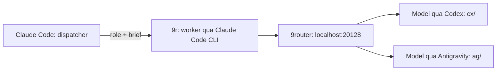

# Agent Company

Hệ thống điều phối agent cho **Claude Code**, gồm CLI `9r`, hai skill điều phối `engineering` / `marketing` và MCP server `company-tools`.

Claude ở phiên chính làm **dispatcher**: chia việc, gọi worker, đọc Handoff Manifest và quyết định bước tiếp theo. Worker tự khảo sát dự án, thực hiện brief và kiểm tra kết quả. Worker vẫn dùng harness Claude Code CLI, nhưng yêu cầu model đi qua **9router** để dùng quota của tài khoản **Codex / Antigravity** đã kết nối, thay vì tạo Claude sub-agent bằng Agent tool.



Luồng làm việc nằm trong [`skills/engineering/SKILL.md`](skills/engineering/SKILL.md) và [`skills/marketing/SKILL.md`](skills/marketing/SKILL.md), không phải một scheduler tự chạy. Theo quy trình mặc định, dispatcher không tự đọc toàn bộ codebase/diff hay làm thay worker; có thể xử lý trực tiếp việc nhỏ, khi người dùng yêu cầu, hoặc khi cần đào sâu sau lỗi/thiếu bằng chứng.

## Yêu cầu

| Thành phần | Yêu cầu |
| --- | --- |
| Hệ điều hành | macOS hoặc Linux, có Bash và Git. |
| Claude Code CLI | Lệnh `claude` đã cài và cấu hình; cần hỗ trợ các cờ mà [`bin/9r`](bin/9r) sử dụng, gồm `--agents`, `--effort`, `--json-schema` và cấu hình MCP. |
| 9router | Chạy riêng tại `http://localhost:20128`, đã hoàn tất thiết lập và kết nối tài khoản Codex / Antigravity. Repo không cài 9router hay đăng nhập provider thay bạn. |
| Python | `python3` **3.12+**, có module `sqlite3`; cần hỗ trợ `venv` nếu không dùng `uv`. |
| Công cụ dòng lệnh | `sqlite3`, `curl` và lệnh **`timeout`** nhận thời lượng như `45m`. Trên macOS có thể cần GNU coreutils; phải có tên lệnh `timeout` trong `PATH`, không chỉ `gtimeout`. Installer chưa kiểm tra lệnh này. |
| `uv` | Khuyến nghị. Nếu thiếu, installer dùng `python3 -m venv` và `pip`. |
| Habblaud, nếu dùng | Node.js / npm và môi trường Docker / Compose để chạy quy trình `npm run docker:up` của upstream. |

Installer kiểm tra `claude`, `python3`, `sqlite3`, `curl`, phiên bản Python và hỗ trợ SQLite. Các dependency Python trong [`requirements.txt`](requirements.txt) được cài vào `~/.claude/company/.venv`.

## Cài nhanh

Ba bước: **clone → cài → kiểm tra**. Thay `<URL_REPO>` bằng URL clone của repo bạn dùng; ví dụ không giả định một remote công khai.

**1. Clone và vào checkout:**

```bash
git clone '<URL_REPO>' agent-company
cd agent-company
```

**2. Cài đặt:**

```bash
./install.sh
```

Installer hỏi xác nhận và API key 9router nếu chưa có key đã lưu. Lấy key trong dashboard 9router → **API Keys**. Giữ checkout này tại chỗ: các file được cài bằng symlink, nên cập nhật checkout sẽ cập nhật các file liên kết.

**3. Kiểm tra:**

```bash
9r
claude mcp list
```

`9r` không có đủ hai đối số sẽ in cách dùng và bảng role, rồi thoát với **mã 2**; đây không phải một lần chạy worker hay kiểm tra model. Chạy `claude mcp list` riêng và kiểm tra mục `company-tools`. Khởi động lại Claude Code sau khi cài.

Nếu shell chưa tìm thấy `9r`, thêm dòng sau vào cấu hình shell rồi mở terminal mới:

```bash
export PATH="$HOME/.local/bin:$PATH"
```

### Cờ của `install.sh`

| Cờ | Hành vi |
| --- | --- |
| `--dry-run` | Kiểm tra điều kiện và xem trước thay đổi; không cài dependency, ghi file/DB, đăng ký MCP hoặc gửi yêu cầu model. Không hỏi key. |
| `--yes` | Bỏ câu hỏi xác nhận. Chạy không tương tác phải có `NINER_KEY` hoặc key đã lưu; không tự tạo key. |
| `--no-combos` | Không gọi script áp dụng combo; giữ nguyên cấu hình combo hiện tại của 9router. |
| `--with-habblaud DIR` | Chạy `habblaud/setup-habblaud.sh` với thư mục đích sau phần cài chính. Không chạy `npm install` hay khởi động Docker. |
| `-h`, `--help` | In cách dùng và thoát. |

### Những gì được cài

- Symlink `bin/9r` vào `~/.local/bin/9r`.
- Symlink `workers.json`, `contract.md`, `tools.py`, `mcp_server.py`, `schemas` từ `company/` vào `~/.claude/company/`.
- Symlink hai skill điều phối vào `~/.claude/skills/engineering` và `~/.claude/skills/marketing`.
- Tạo/reuse `.venv`, lưu `9router.key`, tạo `mcp.json` và khung plugin `eng` / `mkt` dưới `~/.claude/company/`.
- Cập nhật riêng khối `company-9r:begin` / `company-9r:end` trong `~/.claude/CLAUDE.md`, giữ nội dung ngoài khối.
- Đăng ký MCP `company-tools` ở user scope nếu chưa có; áp dụng combo trừ khi chọn `--no-combos`.

Các đích cần thay thế được sao lưu với hậu tố `.bak-…`. Installer không tự sửa một mục MCP `company-tools` đã đăng ký sẵn.

## Cấu hình

### Key, effort và timeout

| Biến / file | Mặc định và cách dùng |
| --- | --- |
| `NINER_KEY` | Đầu vào **cho installer**, là API key của 9router. Nếu không đặt, installer giữ key đã lưu hoặc hỏi khi chạy tương tác. Key phải là một token ASCII không có khoảng trắng. |
| `~/.claude/company/9router.key` | Key mà `9r` đọc khi chạy worker; installer ghi với quyền `600`. Đặt `NINER_KEY` lúc chạy `9r` không thay thế file này. |
| `NINER_EFFORT` | Mặc định **`max`**, truyền vào `claude --effort` cho mọi role. Có thể đổi cho từng lần gọi hoặc export trong shell; giá trị phải được phiên bản Claude Code của bạn hỗ trợ. |
| `NINER_TIMEOUT` | Mặc định **`45m`**, là thời hạn cho tiến trình worker `claude` qua lệnh `timeout`. |

Ví dụ đổi effort hoặc tăng thời hạn cho một nhiệm vụ:

```bash
NINER_EFFORT=high 9r docs_writer "Task DOCS. Cập nhật README khớp code hiện tại. Files: README.md."
NINER_TIMEOUT=60m 9r qa "Task QA. Chạy các test hiện có, ghi kết quả thật; không sửa file."
```

Để cài không tương tác, cung cấp `NINER_KEY` qua môi trường an toàn rồi chạy `./install.sh --yes`. Không ghi key thật vào README, script hoặc lịch sử lệnh dùng chung. Muốn xoay key đã lưu, chạy lại installer với `NINER_KEY` mới; chỉ chạy lại tương tác sẽ reuse key cũ nếu file còn tồn tại.

### Combo và thứ tự fallback

[`9router/combos.json`](9router/combos.json) là nguồn cấu hình các combo. `9r` chọn tên combo từ [`company/workers.json`](company/workers.json); thứ tự model từ trái sang phải biểu thị **ưu tiên → fallback**. Việc chuyển model do 9router xử lý, không phải một vòng retry do `9r` triển khai và không phải chạy đồng thời tất cả model.

| Combo | Model ID đang khai báo, theo thứ tự |
| --- | --- |
| `w-think` | `cx/gpt-6-astra` → `ag/gemini-4-argon-high` → `cx/gpt-6.1-sol` → `ag/gemini-3.8-flash-high` → `ag/claude-sonnet-4-6` |
| `w-code` | `cx/gpt-6-astra` → `cx/gpt-6.1-sol` → `ag/gemini-4-argon-high` → `ag/gemini-3.8-flash-high` → `ag/claude-sonnet-4-6` |
| `w-ui` | `ag/gemini-4-argon-high` → `cx/gpt-6-astra` → `cx/gpt-6.1-sol` → `ag/gemini-3.8-flash-high` → `ag/claude-sonnet-4-6` |
| `w-review` | `cx/gpt-6-astra` → `cx/gpt-6.1-sol` → `ag/gemini-4-argon-high` → `ag/gemini-3.8-flash-high` → `ag/claude-sonnet-4-6` |
| `w-fast` | `cx/gpt-6.1-sol` → `cx/gpt-6-astra` → `ag/gemini-4-argon-high` → `ag/gemini-3.8-flash-high` → `ag/claude-sonnet-4-6` |

**Đây là danh sách cấu hình, không phải cam kết các model đều tồn tại hoặc dùng được trên mọi máy.** Model `cx/…` và `ag/…` phụ thuộc provider, tài khoản đã kết nối và quyền truy cập của bạn. Kiểm tra thực tế rồi sửa `combos.json` cho phù hợp:

```bash
python3 9router/apply-combos.py --dry-run
python3 9router/apply-combos.py --check
```

Lưu ý về [`apply-combos.py`](9router/apply-combos.py):

- Mặc định đọc DB có sẵn tại `~/.9router/db/data.sqlite`; dùng `--db /duong/dan/data.sqlite` nếu khác.
- Chỉ tạo/cập nhật các tên combo có trong JSON, giữ các combo khác. Trước khi ghi thay đổi, tạo bản sao SQLite trong `~/.9router/db/backups/`.
- **`--check` vẫn áp dụng combo trước**, sau đó gửi yêu cầu nhỏ tới từng model duy nhất và in `OK` / `ERR`. Việc này **dùng quota provider**, không chỉ đọc danh sách `/v1/models`.
- `--dry-run` không ghi DB và không gửi yêu cầu model, kể cả khi đi cùng `--check`.
- Nếu chưa có DB, script in hướng dẫn mở 9router rồi kết thúc mà chưa áp dụng hay kiểm tra model. Hoàn tất setup 9router rồi chạy lại.

Sau khi sửa danh sách, chạy lại `python3 9router/apply-combos.py` hoặc lệnh có `--check` để đưa cấu hình vào DB. Cài đặt mặc định cũng gọi script này nhưng **không** tự kiểm tra từng model.

### Postiz — tuỳ chọn

Không cần Postiz để chạy worker kỹ thuật hoặc tạo nội dung. Nếu dùng công cụ Postiz, sao chép mẫu [`config/postiz.env.example`](config/postiz.env.example):

```bash
cp config/postiz.env.example ~/.claude/company/postiz.env
chmod 600 ~/.claude/company/postiz.env
```

Sửa file và điền **cả `POSTIZ_API_URL` lẫn `POSTIZ_API_KEY`** bằng giá trị thật. Không có URL Postiz mặc định; mẫu dùng dạng URL Public API `https://your-postiz-host/api/public/v1`.

- Biến môi trường của tiến trình MCP được ưu tiên; file bù các trường còn thiếu. `POSTIZ_ENV_FILE` đổi đường dẫn file cấu hình, mặc định `~/.claude/company/postiz.env`.
- `POSTIZ_MEDIA_CACHE` đổi vị trí cache ảnh, mặc định `~/.claude/company/postiz_media.json`. `upload_postiz_asset` lưu ánh xạ ID → path để các lần đăng/sửa gửi đủ thông tin ảnh.
- `9r` chạy với môi trường được làm sạch, nên không trông chờ biến Postiz export ở dispatcher tự truyền tới worker; file cấu hình mặc định là cách dùng chung được hỗ trợ.
- Theo skill marketing, dispatcher lấy kênh bằng `get_postiz_channels`, upload ảnh rồi tạo bài qua `publish_to_postiz`. Mặc định là `draft`; chỉ chọn `schedule` khi người dùng yêu cầu rõ và đã duyệt. Khi sửa bằng `edit_postiz_post`, phải truyền đủ `media_ids` muốn giữ; `[]` nghĩa là bỏ ảnh.

## Các role worker

Nguồn: [`company/workers.json`](company/workers.json). Tên role là đối số thứ nhất của `9r`.

| Role | Combo | Mô tả |
| --- | --- | --- |
| `architect` | `w-think` | Khảo sát repo, viết spec và chia nhiệm vụ; không cài đặt code sản phẩm. |
| `coder` | `w-code` | Backend, API, database và core logic theo spec. |
| `frontend` | `w-ui` | UI component, CSS token, responsive và accessibility. |
| `qa` | `w-think` | Viết/chạy unit, integration, E2E test và kiểm tra ca biên. |
| `security_reviewer` | `w-review` | Rà soát bảo mật diff, OWASP, race condition và breaking change; không sửa code. |
| `devops` | `w-code` | Dockerfile, Compose, CI/CD, chiến lược triển khai và rollback; không deploy production. |
| `strategist` | `w-code` | Mục tiêu chiến dịch, ICP, USP, content pillar và Campaign Brief. |
| `content` | `w-code` | Nội dung đa kênh theo PAS, AIDA hoặc Storytelling. |
| `seo_writer` | `w-fast` | Search intent, heading, slug, meta và internal link. |
| `social_growth` | `w-ui` | Hook A/B, kịch bản video ngắn và chuỗi Threads/X. |
| `design` | `w-ui` | Prompt ảnh AI và banner SVG/HTML tự chứa theo kích thước được giao. |
| `qc` | `w-think` | Kiểm định nội dung/asset theo sáu tiêu chí và chạy `run_marketing_gate`. |
| `debugger` | `w-think` | Tìm nguyên nhân gốc của bug, test fail hoặc lỗi CI bằng bằng chứng. |
| `docs_writer` | `w-fast` | README, docs, hướng dẫn cài đặt và changelog khớp code. |

Gọi worker từ thư mục dự án:

```bash
9r docs_writer "Task README. Chỉ cập nhật README.md theo code hiện tại. Files: README.md. Không sửa file khác."
```

`9r` nhận **role + brief**, không phải các cờ riêng cho từng role. Hãy ghi rõ mục tiêu, danh sách `Files`, tiêu chí nghiệm thu và lệnh test trong brief. Worker nhận [`company/contract.md`](company/contract.md) và schema đầu ra; thiếu thông tin thì trả `requires_decision: true` thay vì hỏi tương tác.

CLI in manifest rút gọn và dòng trạng thái. Manifest đầy đủ, bao gồm bằng chứng, được lưu dưới `~/.cache/company-runs/manifests/`. Chỉ `architect` và `strategist` được thêm thư mục chia sẻ `~/.cache/company-runs` vào vùng ghi. Dispatcher cần đối chiếu manifest với Git, không xem `manifest=ok` là bằng chứng test đã chạy.

MCP `company-tools` cung cấp quản lý worktree, kiểm tra phạm vi Git, engineering/marketing gate, kiểm tra manifest và các công cụ Postiz. `9r` không tự tạo worktree hay chạy toàn bộ gate: các bước đó thuộc quy trình điều phối trong skill.

## Skill điều phối và bộ skill kiến thức

Hai skill điều phối trong `skills/` được kèm theo repo. **Các bộ skill kiến thức chuyên ngành mà prompt worker có thể nhắc đến không được đóng gói vì lý do giấy phép.**

Installer tạo khung `plugins/eng` và `plugins/mkt` dưới `~/.claude/company/`, có metadata plugin nhưng thư mục `skills/` ban đầu rỗng. Worker vẫn chạy bình thường bằng prompt, tool, contract và schema; skill chuyên ngành chưa cài thì không khả dụng.

Bạn có thể tự thêm các skill mà mình có quyền sử dụng vào:

```text
~/.claude/company/plugins/eng/skills/<ten-skill>/SKILL.md
~/.claude/company/plugins/mkt/skills/<ten-skill>/SKILL.md
```

`9r` nạp plugin `eng` cho role kỹ thuật và `mkt` cho role marketing. Tôn trọng giấy phép riêng của từng bộ skill; giấy phép MIT của repo không cấp lại quyền cho nội dung bên thứ ba không được kèm theo.

## Habblaud — văn phòng ảo tuỳ chọn

[Habblaud](https://github.com/marmottajr/habblaud) là **dự án bên thứ ba, giấy phép MIT**, cung cấp văn phòng ảo hiển thị agent Claude Code / Codex. Nó không cần thiết để chạy `9r`.

Repo này không chứa toàn bộ Habblaud, chỉ có script [`habblaud/setup-habblaud.sh`](habblaud/setup-habblaud.sh), commit upstream được ghim trong [`habblaud/UPSTREAM_COMMIT`](habblaud/UPSTREAM_COMMIT) và một patch nhỏ: bỏ qua phiên observer của `claude-mem` có thư mục làm việc dưới `.claude-mem/observer-sessions`.

```bash
./install.sh --with-habblaud ~/habblaud
cd ~/habblaud
npm install
npm run docker:up
```

Script clone upstream nếu thư mục đích chưa có, checkout commit đã ghim ở chế độ detached HEAD và áp dụng patch. Nó kiểm tra thay đổi cục bộ trong các file bị patch và dừng khi không thể áp dụng an toàn; không tự cài npm dependency hay chạy Docker.

**Không commit `docker-compose.override.yml` trong checkout Habblaud.** Quy trình upstream sinh file này với đường dẫn của máy và email của bạn.

## Xử lý sự cố

| Triệu chứng | Kiểm tra / xử lý |
| --- | --- |
| `9r: 9router is not reachable on :20128`, **mã 3** | Preflight tới `http://localhost:20128/v1/models` thất bại trong giới hạn 5 giây; HTTP lỗi cũng bị coi là thất bại. Kiểm tra 9router đang chạy đúng cổng và endpoint truy cập được. Repo không tự khởi động 9router. |
| Codex báo `token_revoked` | Kiểm tra và xác thực/kết nối lại tài khoản Codex trong 9router, rồi chạy lại `--check`. Key của 9router và token provider là hai lớp khác nhau; repo không có bước tự đăng nhập lại Codex. |
| Model trả **404** | Đối chiếu model ID với provider/tài khoản đang kết nối. Chạy `python3 9router/apply-combos.py --check`, sửa các ID không dùng được trong `combos.json` rồi áp dụng lại; không giả định mọi model `cx/` / `ag/` đều sẵn có. |
| **401** khi chạy từ app desktop | Dùng wrapper `9r`: nó chạy `env -i` để bỏ biến auth từ desktop, rồi đặt `ANTHROPIC_BASE_URL=http://localhost:20128/api` và `ANTHROPIC_API_KEY` từ `9router.key`. Nếu vẫn lỗi, kiểm tra key trên dashboard và cập nhật file qua installer với `NINER_KEY` mới; export key ở phiên cha không ghi đè file mà `9r` dùng. |
| Worker dừng sau **45 phút** | Đây là `NINER_TIMEOUT` mặc định. Chia nhỏ brief hoặc chủ động tăng, ví dụ `NINER_TIMEOUT=60m 9r qa "Task QA. Chạy test hiện có; không sửa file."`. `9r` trả mã lỗi của worker/`timeout`, không tự resume; kiểm tra các thay đổi đã ghi trước khi chạy lại. |
| `timeout: command not found` hoặc không tìm thấy `9r` | Đảm bảo có lệnh `timeout` trong `PATH` và thêm `~/.local/bin` vào `PATH`. Installer không tự cài các công cụ hệ thống này. |
| Script combo báo không có DB | Mở `http://localhost:20128`, hoàn tất setup để tạo DB rồi chạy lại; nếu DB ở nơi khác, truyền `--db`. Thông báo này không chứng minh model đã được kiểm tra. |

## Bảo mật

- **Không commit `9router.key`, `postiz.env`, `postiz_media.json`**, credential thật hoặc các bản sao lưu chứa chúng. [`.gitignore`](.gitignore) đã loại các tên runtime này và file `.bak*` trong repo; vẫn phải kiểm tra trước khi chia sẻ log hoặc backup.
- Installer ghi key với quyền `600`; tự đặt `chmod 600` cho `postiz.env`. Bản sao DB 9router cũng có thể chứa dữ liệu nhạy cảm.
- Worker chạy không tương tác với **allowlist Bash** trong `allowed_tools` của [`bin/9r`](bin/9r), gồm Git chỉ đọc và các lệnh test/lint/build được liệt kê. Đây không phải quyền chạy shell tuỳ ý hoặc sự thay thế cho kiểm soát phạm vi file và rà soát diff.
- Hợp đồng worker cấm commit, push, reset, xoá hàng loạt và cài dependency mới nếu brief chưa cho phép. Dispatcher phải kiểm tra `files_changed` với `git status` hoặc `verify_git_scope`.
- Wrapper tắt hooks và auto-memory cho phiên worker, dùng plugin của đội và MCP config riêng. Các tool upload/đăng/sửa Postiz không nằm trong allowlist worker; quy trình marketing giao các thao tác đó cho dispatcher sau khi người dùng duyệt.

## Gỡ cài đặt

Cú pháp: `./uninstall.sh [--purge]`. Có thể xem trước hoặc chạy không tương tác bằng `--dry-run` và `--yes`.

```bash
./uninstall.sh
```

Mặc định, script gỡ các symlink trỏ đúng checkout này, khối `company-9r` trong `CLAUDE.md`, cấu hình sinh tự động chưa bị tuỳ biến và mục MCP `company-tools` ở user scope. Nó giữ `9router.key`, `postiz.env`, `.venv`, plugin tự thêm và backup.

```bash
./uninstall.sh --purge
```

`--purge` xoá thêm **`9router.key`, `postiz.env` và `.venv`**. Kể cả khi purge, script vẫn giữ backup, file không liên quan (bao gồm cache `postiz_media.json`), plugin tuỳ biến và **toàn bộ combo 9router**. Không tự khôi phục backup, xoá checkout repo hay gỡ Habblaud.

## Giấy phép

Repo được phát hành theo [MIT License](LICENSE). Habblaud và các skill bên thứ ba chịu giấy phép riêng của chúng.

## English summary

Agent Company makes Claude Code the dispatcher for engineering and marketing workers. The `9r` CLI starts Claude Code worker sessions routed through local 9router (`localhost:20128`) to connected Codex / Antigravity accounts, returning structured handoff manifests.

Install with `./install.sh`, then check `9r` and `claude mcp list`. Model availability depends on your connected accounts: edit `9router/combos.json` and run `python3 9router/apply-combos.py --check` (uses provider quota). Postiz and the third-party MIT-licensed Habblaud virtual office are optional; domain knowledge skill packs are not bundled. Never commit credentials or runtime caches. This repository is MIT-licensed.
